# 🎨 Muhammad Shayan — Portfolio Mockup & UI Prototype

[](https://github.com/shayann07/portfolio-mockup)
[](https://react.dev/)
[](https://vitejs.dev/)
[](https://tailwindcss.com/)
[](https://lenis.darkroom.engineering/)
[](https://www.framer.com/motion/)
[](LICENSE)

> A polished, dark-themed developer portfolio UI mockup built with **React 18**, **Vite 6**, **Tailwind CSS**, **Lenis Smooth Inertial Scroll**, and **Framer Motion** fluid section choreography.

---

## 📖 Overview

**portfolio-mockup** is a high-fidelity single-page portfolio prototype engineered to explore sleek dark-mode aesthetics, custom OKLCH color palettes, lazy-loaded section architectures, and inertial smooth scrolling. It provides a modular component foundation showcasing work history, engineering capabilities, lab projects, and interactive command interfaces.

### Visual & Interactive Concept
- **Inertial Momentum Scrolling**: Powered by **Lenis**, delivering custom exponential easing curves (`1.001 - 2^(-10t)`) for an ultra-smooth native-feeling scroll experience on desktop viewports.
- **Ambient Cursor Glow**: Dynamic radial gradient illumination following the pointer coordinates across dark glassmorphic cards.
- **Lazy-Loaded Component Pipelines**: Above-the-fold prioritization with React `Suspense` and `lazy` boundaries for heavy below-the-fold modules.
- **Structured SEO & Metadata**: Comprehensive OpenGraph tags, Twitter cards, and Schema.org JSON-LD microdata powered by `react-helmet-async`.

---

## 🏗️ Architecture & Component Hierarchy

```mermaid
graph TD
    subgraph AppRoot ["Root Entry & SEO"]
        App["App.tsx"]
        MetaHead["SEO/MetaHead.tsx<br/>(OpenGraph & Twitter Meta)"]
        StructuredData["SEO/StructuredData.tsx<br/>(JSON-LD Schema)"]
        Cursor["CursorGlow.tsx<br/>(Pointer Vector Radial Glow)"]
    end

    subgraph AboveTheFold ["Critical Above-the-Fold View"]
        Navbar["sections/Navbar.tsx"]
        Hero["sections/HeroSection.tsx"]
    end

    subgraph LazySections ["Suspense Lazy-Loaded Sections"]
        CommandCenter["sections/CommandCenterSection.tsx"]
        Story["sections/StorySection.tsx"]
        Skills["sections/SkillsSection.tsx"]
        Projects["sections/ProjectsSection.tsx"]
        Lab["sections/LabSection.tsx"]
        CTA["sections/CTASection.tsx"]
        Contact["sections/ContactSection.tsx"]
        Footer["sections/Footer.tsx"]
    end

    App --> MetaHead
    App --> StructuredData
    App --> Cursor
    App --> Navbar
    App --> Hero
    App --> CommandCenter
    App --> Story
    App --> Skills
    App --> Projects
    App --> Lab
    App --> CTA
    App --> Contact
    App --> Footer
```



---

## ✨ Visual Features & Interactive Capabilities

- **Smooth Lenis Scroll Engine**: Custom-configured vertical RAF loop with touch multipliers (`2.0`) and wheel multipliers (`1.0`), automatically disabled on mobile devices for battery and performance optimization.
- **Interactive Command Center**: HUD-inspired command section offering quick terminal-style jumps across projects and technical summaries.
- **Glassmorphic Card Elevation**: Tailwind CSS backdrop-filter blur effects paired with OKLCH neutral tokens (`oklch(0.145 0 0)` to `oklch(0.872 0.01 258.338)`).
- **Responsive Navigation Pill**: Floating sticky navigation bar with active route highlight and micro-animations.
- **Rich Structured Schema**: Injected JSON-LD Person and WebSite schema for search engine indexation.

---

## 📱 Key Sections & Modules

| Section / Component | File Location | Purpose & Capabilities |
|---|---|---|
| **Hero Section** | [`src/sections/HeroSection/`](file:///d:/Work/github_full_account/portfolio-mockup/src/sections/HeroSection) | Headline presentation, primary call-to-action, and status tags |
| **Command Center** | [`src/sections/CommandCenterSection/`](file:///d:/Work/github_full_account/portfolio-mockup/src/sections/CommandCenterSection) | Interactive control dock and quick action matrix |
| **Story & Bio** | [`src/sections/StorySection/`](file:///d:/Work/github_full_account/portfolio-mockup/src/sections/StorySection) | Narrative career summary and engineering philosophy |
| **Skills Grid** | [`src/sections/SkillsSection/`](file:///d:/Work/github_full_account/portfolio-mockup/src/sections/SkillsSection) | Categorized technical proficiency matrix |
| **Projects Showcase** | [`src/sections/ProjectsSection/`](file:///d:/Work/github_full_account/portfolio-mockup/src/sections/ProjectsSection) | Interactive cards featuring mobile and web development builds |
| **Lab Experiments** | [`src/sections/LabSection/`](file:///d:/Work/github_full_account/portfolio-mockup/src/sections/LabSection) | Creative prototypes, micro-tooling, and open-source explorations |
| **Contact Dock** | [`src/sections/ContactSection/`](file:///d:/Work/github_full_account/portfolio-mockup/src/sections/ContactSection) | Direct inquiry form with interactive field states |
| **Cursor Glow Halo** | [`src/components/CursorGlow.tsx`](file:///d:/Work/github_full_account/portfolio-mockup/src/components/CursorGlow.tsx) | GPU-driven radial gradient pointer trail |

---

## 🛠️ Technical Stack Matrix

| Domain | Technology | Version | Description / Purpose |
|---|---|---|---|
| **UI Library** | React | `^18.2.0` | Declarative component UI library |
| **Build System** | Vite | `6.3.5` | Next-generation fast frontend bundler |
| **Styling** | Tailwind CSS | `3.4.16` | Utility-first CSS framework with custom theme extensions |
| **Smooth Scroll** | Lenis | `^1.3.16` | High-performance inertial scrolling engine |
| **Animation** | Framer Motion | `^11.0.0` | Motion graphics and staggered entry transitions |
| **Primitive Components** | Radix UI | `^1.1.0` | Accessible toggle and slot primitives |
| **SEO & Head** | React Helmet Async | `^2.0.5` | Asynchronous `<head>` and meta management |
| **Icons** | Lucide React | `^0.453.0`| Clean vector icon set |

---

## 🚀 Getting Started

### Prerequisites
- **Node.js**: `v18.x` or higher
- **Package Manager**: `npm` or `yarn`

### Installation & Local Development

1. **Clone the Repository**:
   ```bash
   git clone https://github.com/shayann07/portfolio-mockup.git
   cd portfolio-mockup
   ```

2. **Install Dependencies**:
   ```bash
   npm install
   ```

3. **Start Local Development Server**:
   ```bash
   npm run dev
   ```
   Navigate to `http://localhost:5173` to view the mockup.

4. **Build for Production**:
   ```bash
   npm run build
   ```

---

## 📄 License

This project is licensed under the [MIT License](LICENSE) — Copyright (c) 2026 [shayann07](https://github.com/shayann07).
